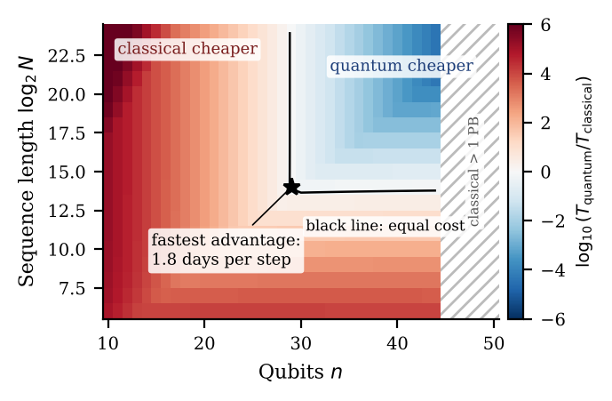
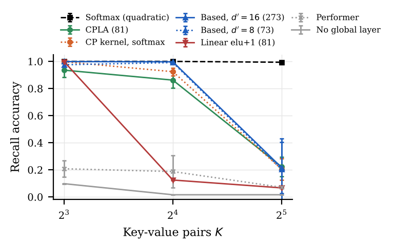

# Quantum Attention Is a Kernel, Not a Speedup

**Training-Cost Bounds and Linear-Time Recall for Transformers**

Chandra Sekhar Singuru · Independent Researcher · [ORCID 0009-0004-0219-1960](https://orcid.org/0009-0004-0219-1960)

Builds on Paper 1: https://github.com/Chandra953/Quantum-Fidelity-Attention

## Key results

| Finding | Evidence |
|---|---|
| Mean fidelity score decays as 2^-n; gradient variance as ~4^-n (3.97, 95% CI 3.85–4.06, L=4) | `results/scaling.csv` |
| Theorem: any quantum-advantage regime needs ≥ (1+2P)² F / (24 a R_s²) per training step | `src/feasibility.py` |
| ≥ 64 years/step at 10^4 shots/s, ≥ 1.5 days at 10^6; 72-scenario sweep agrees | `results/feasibility_sensitivity.csv` |
| Exact 3^n feature map for the cosine-product kernel (CPLA) | Proposition 1, `src/recall.py` |
| Same 81-dim state: CPLA 86% recall at K=16 vs 12.5% for linear elu+1 attention | `results/recall_*.csv` |
| Based (Taylor kernel) stays 4–13 points ahead; no fixed-state method survives K=32 | `results/recall_*.csv` |




## Layout
```
src/scaling.py       gradient variance and score mean vs qubits (n = 2..12)
src/feasibility.py   quantum vs exact-classical training cost, sensitivity sweep
src/recall.py        multi-query associative recall, 2-layer Transformers, 8 attention variants
paper/               IEEEtran source, figures, compiled PDF
results/             raw CSVs behind every number
```
`scaling.py` imports the validated statevector simulator from Paper 1's repository (clone it next to this one).

## Reproduce
```bash
python src/scaling.py 400
python src/feasibility.py
W=window-w4; python src/recall.py "$W+softmax,$W+cpla,$W+cp-softmax,$W+taylor-d8,$W+taylor-d16,$W+elu-d81,$W+performer-d16,$W+window-w4" 8,16,32 3
cd paper && python make_figures.py && latexmk -pdf paper.tex
```

## Disclosure
Generative AI tools assisted with code development, experiment design and drafting. The author reviewed, verified and takes responsibility for all content.
