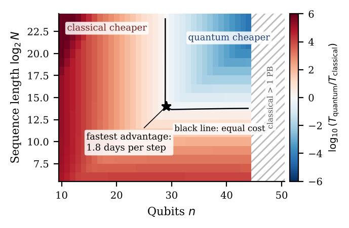
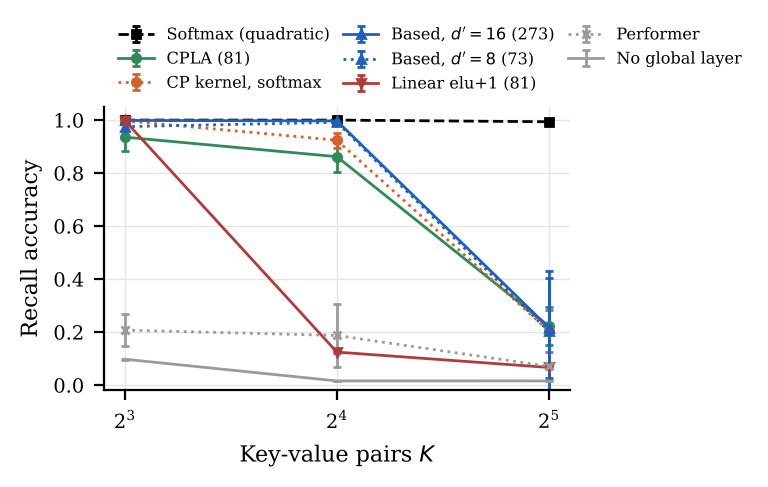

# Quantum Attention Is a Kernel, Not (Yet) a Speedup

**Training-Cost Bounds and Linear-Time Recall for Transformers**

> **Quantum attention is too costly to train on quantum hardware today, but the kernel inside it is useful for recall tasks in AI right now.**

| Part | Question | Finding |
|---|---|---|
| 1. Training cost (quantum computing) | How long would it take to train a Transformer with quantum attention on real hardware? | Wherever quantum would beat classical simulation, each training step takes days to years with today's methods. Not (yet) a speedup. |
| 2. Linear-time recall (AI) | Is the kernel hidden inside quantum attention useful in classical Transformers? | For recall, yes. Run classically at linear cost (CPLA), it recalls 86% vs 12.5% for linear attention with the same memory. |

Here "cost" means compute: time and number of quantum circuit runs, not money.

Chandra Sekhar Singuru · Independent Researcher · [ORCID 0009-0004-0219-1960](https://orcid.org/0009-0004-0219-1960)

Builds on Paper 1: https://github.com/Chandra953/Quantum-Fidelity-Attention

## Key results

| Finding | Evidence |
|---|---|
| Mean fidelity score decays as 2^-n; gradient variance as ~4^-n (3.97, 95% CI 3.85–4.06, L=4) | `results/scaling.csv` |
| Theorem: any quantum-advantage regime needs ≥ κ² F / (24 a R_s²) per training step (κ = 1+2P for parameter shift, κ = 3 for an ideal gradient estimator) | `src/feasibility.py` |
| Parameter shift: ≥ 64 years/step at 10^4 shots/s, ≥ 1.5 days at 10^6. Ideal gradients: ≥ 9.8 h at 10^4, ≥ 3.5 s at 10^6. 144-scenario sweep agrees | `results/feasibility_sensitivity.csv` |
| Exact 3^n feature map for the cosine-product kernel (CPLA) | Proposition 1, `src/recall.py` |
| Same 81-dim state: CPLA 86% recall at K=16 vs 12.5% for linear elu+1 attention | `results/recall_*.csv` |
| Based (Taylor kernel) stays 4–13 points ahead; no fixed-state method survives K=32 | `results/recall_*.csv` |
| Same scaling picture for a second circuit design (RX encoding, RY-RZ layers, CZ chain); sweep within 3.4x | `src/scaling_design_b.py`, `results/scaling_design_b.csv` |
| IBM hardware (ibm_fez, 120 circuits): measured scores match exact ones, r = 0.998; mean decays as 2.09^-n | `src/hardware_ibm.py`, `results/hardware_ibm.csv` |
| Character-level WikiText-2: no gain from CPLA (2.081 BPC vs 1.986 for linear attention); its benefit is specific to recall | `src/lm.py`, `results/lm_wikitext2.csv` |




## Layout
```
src/scaling.py       gradient variance and score mean vs qubits (n = 2..12)
src/scaling_design_b.py   the same for a second circuit design
src/hardware_ibm.py  fidelity scores on IBM quantum hardware (needs your own IBM account)
src/lm.py            character-level WikiText-2 language modelling
src/feasibility.py   quantum vs exact-classical training cost, sensitivity sweep
src/recall.py        multi-query associative recall, 2-layer Transformers, 8 attention variants
tests/               checks that the code matches the paper and the reported numbers follow from results/
paper/               IEEEtran source, figures, compiled PDF
results/             raw CSVs behind every number
```
`scaling.py` imports the validated statevector simulator from Paper 1's repository (clone it next to this one).

## Reproduce
```bash
pip install -r requirements.txt
pytest -q tests          # 35 checks: Proposition 1, causality, cost model, every reported number
python src/scaling.py 400
python src/feasibility.py
W=window-w4; python src/recall.py "$W+softmax,$W+cpla,$W+cp-softmax,$W+taylor-d8,$W+taylor-d16,$W+elu-d81,$W+performer-d16,$W+window-w4" 8,16,32 3
python src/scaling_design_b.py 1600 && python src/feasibility.py --design-b
bash -c "mkdir -p data/wikitext-2 && for s in train valid test; do curl -sL -o data/wikitext-2/$s.txt https://raw.githubusercontent.com/pytorch/examples/main/word_language_model/data/wikitext-2/$s.txt; done"
python src/lm.py "softmax,cpla,taylor-d8,elu-d81,performer-d16,window-w64" 2500 2
cd paper && python make_figures.py && latexmk -pdf paper.tex
```

## Disclosure
Generative AI tools assisted with code development, experiment design and drafting. The author reviewed, verified and takes responsibility for all content.
